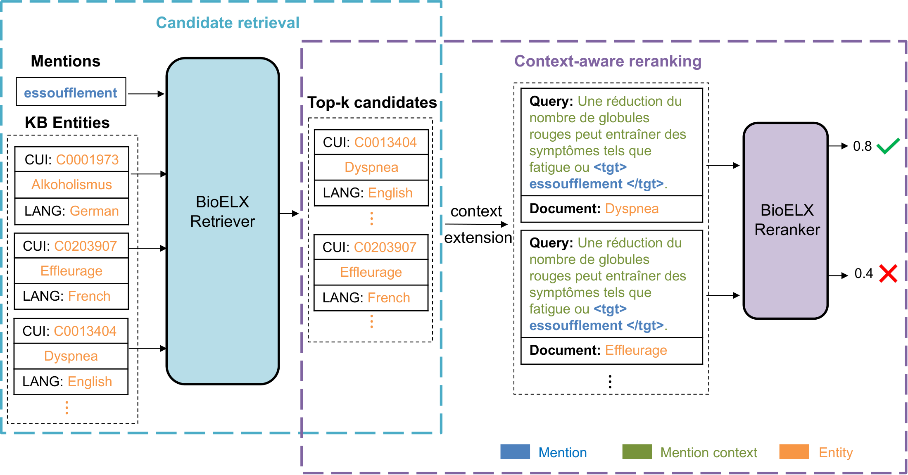

# BioELX

## Overview
BioELX is a two-stage framework for context-aware cross-lingual biomedical entity linking, consisting of a retriever for cross-lingual candidate retrieval and a reranker for context-aware entity disambiguation, without requiring task-specific BEL supervision.



Stage 1 retrieves top-k candidate entities for a mention across languages; stage 2
extends the mention with its context (`<tgt>...</tgt>`) and reranks those candidates.

---
This repository includes code for data processing, retriever training and inference, and reranker inference.

## Updates
- **Updated paper on [arXiv](https://arxiv.org/abs/2605.27380): EMEA, Patent and WikiMed-DE are now evaluated against the full UMLS 2020AA release.** The original EMNLP 2026 Findings version used the Level-0 subset of UMLS 2020AA as the knowledge base for these benchmarks. With the full release, BioELX improves over the originally reported numbers on all three benchmarks (see [All version comparison](#all-version-comparison)). XL-BEL and MedMentions results are unchanged.
- We build two versions of the full UMLS 2020AA knowledge base, a lowercased one (main results) and a case-preserving one (Appendix F.2 of the updated paper). See [process_kbs](code/process_kbs/README.md) for how they are built and their sizes.
## Citing
If you use BioELX in your work, please cite the following paper:
```bash
@inproceedings{wang-etal-2026-bioelx,
    title = "{B}io{ELX}: Context-Aware Cross-lingual Biomedical Entity Linking without Task-Specific Supervision",
    author = "Wang, Yi  and
      Dima, Corina  and
      Zhong, Liangyu  and
      Staab, Steffen",
    editor = "Lee, Hung-Yi  and
      Dev, Sunipa  and
      Li, Jessy  and
      Elliott, Desmond",
    booktitle = "Findings of the {A}ssociation for {C}omputational {L}inguistics: {EMNLP} 2026",
    month = oct,
    year = "2026",
    address = "Budapest, Hungary",
    publisher = "Association for Computational Linguistics",
    url = "https://aclanthology.org/2026.findings-emnlp.1109/",
    doi = "10.18653/2026.findings-emnlp.1109",
    pages = "23462--23488",
    ISBN = "979-8-89176-462-0"
}
```

## Huggingface Resources
Model:
> **[`bioelx-nlp/bioelx_retriever`](https://huggingface.co/bioelx-nlp/bioelx_retriever)**

Dataset:
> **[`bioelx-nlp/bioelx_wikidata_pairs`](https://huggingface.co/datasets/bioelx-nlp/bioelx_wikidata_pairs)**


## Setting up
Python 3.12

Create virtual environment:
```bash
python3.12 -m venv .bioelx
source .bioelx/bin/activate
```

Install the required dependencies with:

```bash
pip install --upgrade pip
pip install -r requirements.txt
```

Datasets and results default to `data/` and `output/` inside the repository (see
[constants.py](code/common/constants.py)). If they live elsewhere -- on a scratch
filesystem, for instance -- point these environment variables at them instead:

```bash
export BIOELX_DATA_DIR=/path/to/data
export BIOELX_OUTPUT_DIR=/path/to/output
```

## Evaluation Datasets
- XL-BEL: **[sapbert repository](https://github.com/cambridgeltl/sapbert/tree/main/evaluation/xl_bel)**, XL-BEL dataset is in `sapbert/tree/main/evaluation/`
- EMEA and Patent: **[Mantra GSC](https://github.com/mi-erasmusmc/Mantra-Gold-Standard-Corpus)**
    - *Note*: There are two version of Mantra dataset, we use the original version published on 2015 in our implementation, which is more difficult than the other version.
    - We use `Mantra-GSC-XML.zip` in our implementation
    - Store it to `data/mantra`
- WikiMed-DE: **[WikiMed-DE on Zenodo](https://zenodo.org/records/8188966)**
    - details of this dataset please check this **[repository](https://github.com/AI4MedCode/wikimed-de)**
    - Store it to `data/wikimed_de`
- MedMentions: **[MedMentions repository](https://github.com/chanzuckerberg/MedMentions)**, we use st21pv version in our implementation 

## Preprocessing datasets
All three annotated corpora are converted by a single script, selected with `--dataset`.

- Input:
    - `mantra/Mantra-GSC-XML.zip`
    - `medmentions/corpus_pubtator.txt` (the st21pv corpus, decompressed) together with the
      three pmid split lists `medmentions/corpus_pubtator_pmids_trng.txt`,
      `medmentions/corpus_pubtator_pmids_dev.txt`, `medmentions/corpus_pubtator_pmids_test.txt`
    - `wikimed_de/test_data_bel.json`

- Output:
    - `.txt` files in XL-BEL format, for example `C0018544||halogène||Procédé de préparation...`,
      where the mention occurrence in the context is wrapped in `<tgt>...</tgt>`
    - saved to `data/mantra/processed/<bucket>/<lang>.txt` (buckets: `EMEA`, `Medline`, `Patent`),
      `data/medmentions/processed/{train,dev,test}.txt` (split by the pmid lists) and
      `data/wikimed_de/processed/test.txt`

- run

With no other arguments, inputs are read from `DATA_DIR/<dataset>` (see
[constants.py](code/common/constants.py)) and outputs are written to
`<input dir>/processed`. Both can be overridden, and `--splits` restricts which
subsets are written:

```bash
python code/preprocessing/to_xl_bel_format.py \
    --dataset mantra \
    --data_path /path/to/data/mantra \       
    --output_path /path/to/save/the/converted/data \
    --splits EMEA Patent                       # default: all buckets

python code/preprocessing/to_xl_bel_format.py --dataset medmentions 
python code/preprocessing/to_xl_bel_format.py --dataset wikimed-de --splits test
```

## Training Dataset

- Followin the instruction in [Wikidata README](code/wikidata/README.md) to obtain the training data `training_file_wikidata2025_uncased_no_dup_pairwise_pair_th.txt`

## Knowledge Bases

Follow the instructions in [process_kbs](code/process_kbs/README.md). For EMEA, Patent and WikiMed-DE, the main results use the lowercased full UMLS 2020AA release (`--lowercase --dedup`).

## Train Retriever
> Only needed if you want to retrain. To just run the pipeline, use our released checkpoint — see [Run Retrieval](#run-retrieval).
- download the **[sapbert repository](https://github.com/cambridgeltl/sapbert/)**
- Follow the instruction of sapbert repository and replace the sapbert training data to ours

## Run Retrieval
**No training required** — our trained retriever is released on the Hugging Face Hub:

> **[`bioelx-nlp/bioelx_retriever`](https://huggingface.co/bioelx-nlp/bioelx_retriever)**

Pass the model id directly to `--sapbert_model`; the weights are downloaded and cached
automatically by `transformers` on first use. A local path to your own checkpoint
(e.g. from [Train Retriever](#train-retriever)) works exactly the same way.

- Inputs:
    - the dataset you want to evaluate. The data should be in XL-BEL format. For example,
    ```txt
    C2295058||Lackschildläusen||Die Laccainsäuren ...
    C0009968||Garkupfer||Saigerhütten  gewannen   <tgt>Garkupfer</tgt>  und  Silber ...
    ```
    - The corresponding knowledge base for the dataset, for example UMLS 2020AA for EMEA dataset.
- Outputs:
    - a txt file containing the mention, its context and the top-k possible candidates.
    - for example:
```txt
[
  {
    "mention": "Lackschildläusen",
    "context_left": "Die Laccainsäuren sind ...",
        "context_right": "  gewonnen wird.",
    "label": [
      "C2295058"
    ],
    "candidate_cuis": [
      "C1002908",
      "C1002908",
      "C1002908",
      ...
      ],
    "candidate_labels": [
      "Laccaria",
      "Laccaria",
      "Laccarias",
      ...
      ],
    "scores": [
      0.802098274230957,
      0.802098274230957,
      0.7999044060707092,
      ...
       ]
  },
  ...
]
```
- Run the following command line:

```bash
python code/sapbert_cl_ctx.py\
  --sapbert_model "bioelx-nlp/bioelx_retriever" \
  --kb_path "the_path_of_the_knowledge_base" \
  --mention_path "the_path_of_the_dataset_to_be_retrieved" \
  --output_path "the_path_you_want_to_store_the_retrieval_result" \
  --top_k 256 \ 
  --context \
  --cache_dir 
```

- `--sapbert_model`: `bioelx-nlp/bioelx_retriever` (our released checkpoint) or a local path to your own
- `--top_k`: integer, how many top-k candidates to keep for each mention
- `--context`: include the mention context in the retrieval query
- `--cache_dir`: where the knowledge base entity embeddings are cached, so they are not recomputed on the next 

## Run Reranking
- Inputs:
  - the retrieved candidates, which is obtained after running retrieval
- Outputs:
  - the reranked results 

```bash
python /code/qwen_inference.py \
  --output_path "the_path_you_want_to_store_the_rerank_result" \
  --data_path "the_path_you_store_the_retrieval_result" \
  --model_size 8B \
  --top_k 16 \
  --cuda cuda:0
```

> **Notes:** `--top_k` is the number of retrieved candidates to rerank. In our experiments, we use `--top_k 64` for XL-BEL and `--top_k 16` for EMEA, Patent and WikiMed-DE (UMLS 2020AA).

## Evaluation
See [evaluation example](./code/evaluation/eval_example.ipynb)

## Results
All numbers are R@1 (%). For BioELX, we report the mean over three random seeds. The released checkpoint [`bioelx-nlp/bioelx_retriever`](https://huggingface.co/bioelx-nlp/bioelx_retriever) is one of them. BioELX reranks the top-**64** retrieved candidates on XL-BEL and the top-**16** on EMEA, Patent and WikiMed-DE (UMLS 2020AA) with Qwen3-Reranker-8B. Best results are in **bold**. For full result, please check Table 1 and Table 2 in our *[updated paper](https://arxiv.org/pdf/2605.27380)*. 

Below are the results for EMEA, Patent and WikiMed-DE using different version of UMLS knowledge bases. 

### UMLS 2020 AA L0 Subset
This version corresponds to the results reported in the *[original version of our paper](https://aclanthology.org/2026.findings-emnlp.1109.pdf)*. 

| Method | EMEA ES | EMEA FR | EMEA NL | EMEA DE | EMEA Avg | Patent FR | Patent DE | Patent Avg | WikiMed-DE DE |
|---|---|---|---|---|---|---|---|---|---|
| BERGAMOT | 60.2† | 58.2† | 54.4† | 53.9† | 56.7† | 68.7† | 68.4† | 68.6† | 51.0† |
| SapBERT-de | 56.5† | 53.4† | 52.5† | 57.7† | 55.0† | 65.5† | 67.2† | 66.4† | 51.3† |
| BioELX retriever | 60.0 | 55.9 | 56.2 | 55.8 | 57.1 | 67.0 | 68.9 | 68.0 | 57.0 |
| BioELX retriever + reranker | **65.4** | **61.9** | **59.9** | **62.7** | **62.5** | **75.4** | **71.4** | **73.4** | **63.0** |

### Full UMLS 2020 AA (Lowercase version)
Main results of the updated paper. `DE` uses UMLS 2020AA as the knowledge base. † marks results reproduced by us.

| Method | EMEA ES | EMEA FR | EMEA NL | EMEA DE | EMEA Avg | Patent FR | Patent DE | Patent Avg | WikiMed-DE DE |
|---|---|---|---|---|---|---|---|---|---|
| BERGAMOT | 65.7† | 61.0† | 59.4† | 58.8† | 61.2† | 71.9† | 62.6† | 67.3† | 53.4† |
| SapBERT-de | 63.9† | 58.9† | 58.8† | 59.1† | 60.2† | 71.9† | 63.2† | 67.6† | 57.2† |
| BioELX retriever | 63.3 | 60.6 | 60.0 | 60.2 | 61.1 | 73.0 | 67.2 | 70.1 | 63.9 |
| BioELX retriever + reranker | **68.9** | **65.4** | **65.6** | **64.6** | **66.1** | **78.8** | **74.2** | **76.5** | **67.0** |

### Full UMLS 2020 AA (Case-preserving)
Appendix F.2 of the updated paper. All numbers are obtained by us under the same evaluation protocol.

| Method | EMEA ES | EMEA FR | EMEA NL | EMEA DE | EMEA Avg | Patent FR | Patent DE | Patent Avg | WikiMed-DE DE |
|---|---|---|---|---|---|---|---|---|---|
| BERGAMOT | 65.7† | 59.9† | 59.0† | 63.5† | 62.0† | 69.3† | 66.7† | 68.0† | 59.3† |
| SapBERT-de | 65.0† | 60.3† | 60.6† | 64.9† | 62.7† | 67.0† | 66.7† | 66.8† | 61.0† |
| BioELX retriever | 63.9 | 61.6 | 60.1 | 63.8 | 62.4 | 70.9 | 68.2 | 69.5 | 64.4 |
| BioELX retriever + reranker | **66.0** | **63.9** | **63.7** | **66.2** | **64.9** | **77.0** | **73.5** | **75.2** | **67.6** |

### All version comparison
BioELX on the three versions of UMLS 2020AA: the Level-0 subset (original EMNLP 2026 Findings version), the lowercased full release (main results of the updated paper) and the case-preserving full release (Appendix F.2 of the updated paper). Best results in each column are in **bold**.

| BioELX | KB | EMEA ES | EMEA FR | EMEA NL | EMEA DE | EMEA Avg | Patent FR | Patent DE | Patent Avg | WikiMed-DE DE |
|---|---|---|---|---|---|---|---|---|---|---|
| Retriever | Level-0 subset | 60.0 | 55.9 | 56.2 | 55.8 | 57.1 | 67.0 | 68.9 | 68.0 | 57.0 |
| Retriever | Full release, lowercased | 63.3 | 60.6 | 60.0 | 60.2 | 61.1 | 73.0 | 67.2 | 70.1 | 63.9 |
| Retriever | Full release, case-preserving | 63.9 | 61.6 | 60.1 | 63.8 | 62.4 | 70.9 | 68.2 | 69.5 | 64.4 |
| Retriever + reranker | Level-0 subset | 65.4 | 61.9 | 59.9 | 62.7 | 62.5 | 75.4 | 71.4 | 73.4 | 63.0 |
| Retriever + reranker | Full release, lowercased | **68.9** | **65.4** | **65.6** | 64.6 | **66.1** | **78.8** | **74.2** | **76.5** | 67.0 |
| Retriever + reranker | Full release, case-preserving | 66.0 | 63.9 | 63.7 | **66.2** | 64.9 | 77.0 | 73.5 | 75.2 | **67.6** |
